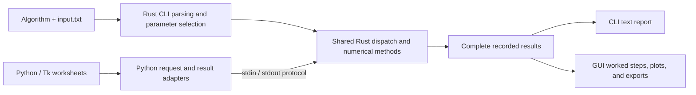

<div align="center">

# Exam Lab

### Learning and Optimization, Step by Step

**Run numerical exercises in Rust and inspect the complete calculation.**
Use interactive Python/Tk worksheets for worked steps and plots, or run the
standalone Rust CLI with text inputs and reproducible reports.

[](rust_backend/Cargo.toml)
[](main.py)
[](ui/)
[](#quick-start)
[](rust_backend/Cargo.toml)

[Quick start](#quick-start) ·
[Algorithms](#algorithms) ·
[Step selection](#step-selection-and-learning-rates) ·
[Reports](#traces-and-reports) ·
[Architecture](#architecture) ·
[Verification](#verification) ·
[Documentation](#documentation)

<sub>Optimization methods · Neural learning · Matrix exercises · Supplied practical examples</sub>

</div>

---

## Why this exists

A numerical exercise is easier to understand when every update can be checked:
the old point or model, the substituted values, the selected step, the new
state, and the exact reason the algorithm stopped.

Exam Lab brings the supplied optimization and neural-learning exercises into
one local application. Rust performs objective evaluation, automatic
differentiation, training, stopping checks, diagnostics, and predictions.
The desktop worksheets and file CLI present those results in forms you can
inspect, compare with hand calculations, and export.

### Key properties

| Property | What you get |
| --- | --- |
| **Two ways to work** | A desktop worksheet for exploring calculations and a Rust CLI for running `.txt` inputs and saving `.txt` reports. |
| **Complete recorded traces** | Optimization points, simplex trials, line searches, pattern updates, epoch summaries, predictions, and neuron calculations, depending on the method. |
| **Explicit algorithm variants** | Fixed-rate, optimized-step, and normalized-gradient descent stay separately selectable. So do Nelder–Mead branches and all four perceptron modes. |
| **Reproducible inputs** | Supplied initialization and sample order are preserved. Completed GUI results keep the input snapshot used for that run. |
| **Local and offline** | Rust and Python standard libraries only. No third-party Rust crates, Python packages, network service, or API key is required to run calculations. |

---

## Quick start

All commands below run from the **repository root, `math`**, which contains
`every_example_gui/`.

### Prerequisites

| Tool | Needed for |
| --- | --- |
| Rust toolchain with `rustc` on `PATH` | All calculations; direct executable builds and the GUI's cached backend build |
| Cargo | The Cargo CLI and Rust test commands below; the direct `rustc` build is also supported |
| Python 3.10+ with Tk | Desktop worksheets; Python is not required for the standalone CLI |
| Python 3.10+ | Python integration tests; desktop tests additionally require Tk and a display |

### 1. Run a CLI calculation

This example runs **steepest descent with an unnormalized negative gradient and
a new step calculated by line search each iteration**:

```sh
cargo run --offline --manifest-path every_example_gui/rust_backend/Cargo.toml -- \
  steepest-line-search \
  --input every_example_gui/cli_templates/optimization/steepest-line-search.txt \
  --output "steepest-descent-report.txt"
```

Cargo builds the executable if needed. The report is saved in the current
directory. Relative and absolute paths are accepted; quote paths with spaces.

Discover the available algorithms and modes:

```sh
cargo run --offline --manifest-path every_example_gui/rust_backend/Cargo.toml -- --help
cargo run --offline --manifest-path every_example_gui/rust_backend/Cargo.toml -- --list
```

**[All algorithm commands →](CLI_COMMANDS.md)** — copy-and-paste commands for
all 11 CLI algorithm names and all 20 templates, including every supported
variant and learning-rate mode.

### 2. Run the normalized-vector method

For **gradientná metóda s normalizovaným vektorom**, use its separate command:

```sh
cargo run --offline --manifest-path every_example_gui/rust_backend/Cargo.toml -- \
  normalized-gradient \
  --input every_example_gui/cli_templates/optimization/normalized-gradient.txt \
  --output "normalized-gradient-report.txt"
```

This recalculates the unit negative-gradient direction and the accepted scalar
step each iteration. The distinction between the descent methods is explained
in [Step selection and learning rates](#step-selection-and-learning-rates).

### 3. Open the desktop worksheets

```sh
python3 every_example_gui/main.py
```

Or launch the package:

```sh
python3 -m every_example_gui.main
```

The first calculation compiles the backend directly with `rustc`; later runs
reuse the cache in `every_example_gui/.cache/rust/`, keyed by source and compiler
version. The GUI does not require a Cargo download. On Linux, Tk may require
your distribution's `python3-tk` package. Check the Tk installation with:

```sh
python3 -m tkinter
```

<details>
<summary>Build once and run the executable directly</summary>

```sh
cargo build --offline --manifest-path every_example_gui/rust_backend/Cargo.toml

every_example_gui/rust_backend/target/debug/exam-adaline normalized-gradient \
  --input every_example_gui/cli_templates/optimization/normalized-gradient.txt \
  --output "normalized-gradient-report.txt"
```

The direct compiler workflow is also available:

```sh
rustc --edition=2021 -O every_example_gui/rust_backend/src/main.rs -o /tmp/exam-cli
/tmp/exam-cli --list
```

On Windows, executable filenames have the `.exe` suffix; choose an appropriate
local output path instead of `/tmp/exam-cli`.

</details>

---

## Algorithms

### Optimization

| Method | CLI command | Desktop | Defining behavior |
| --- | --- | :---: | --- |
| Gradient Method · 1D | `gradient-1d` | ✓ | Fixed positive rate; analytic first derivative from automatic differentiation. |
| Newton's Method · 1D | — | ✓ | Automatic or supplied derivatives; strict post-update step test and inclusive `Nmax`. |
| Steepest Gradient Descent · 2D, fixed rate | `steepest-fixed` | ✓ | Both coordinates update from the same old, unnormalized gradient using one fixed rate. |
| Steepest Descent · 2D, optimized step | `steepest-line-search` | ✓ | Unnormalized negative gradient; a new accepted step from line search each iteration. |
| Gradient Method · 2D, normalized vector | `normalized-gradient` | ✓ | Unit negative gradient; a new accepted distance from line search each iteration. |
| Newton's Method · 2D | `newton-2d` | ✓ | Full Hessian, including mixed partials; simultaneous coordinate update. |
| Nelder–Mead · 2D | `nelder-mead` | ✓ | Three supplied vertices; `slides` or `standard` branches; `function` or `position` stopping. |
| Powell's Method · 2D | `powell` | ✓ | Three line searches per cycle, raw displacement direction, and the existing direction-shift rule. |

### Neural learning

| Method | CLI command | Desktop | Defining behavior |
| --- | --- | :---: | --- |
| ADALINE | `adaline` | ✓ | Sequential linear-response error updates; strict largest-individual-change stopping after a complete epoch. |
| MADALINE Rule I · MRI | — | ✓ | 1–32 hidden units; target-dependent hidden-unit selection; fixed output weights and bias. |
| Hebbian Learning | `hebb` | ✓ | Zero initialization, target-based updates, one ordered pass, then fixed-model verification. |
| Perceptron | `perceptron` | ✓ | Four separately selectable activation/update modes; stopping requires a complete unchanged epoch. |

Perceptron modes are explicit in the input file:

| `mode` | Activation | Update on a mistake |
| --- | --- | --- |
| `binary` | 0/1; zero net gives 1 | `rate * (target - output)` |
| `bipolar` | −1/+1; zero net gives +1 | `rate * target` |
| `bipolar_error` | −1/+1; zero net gives +1 | `rate * (target - output)` |
| `band` | −1/0/+1; the inclusive threshold band gives 0 | `rate * target` |

The multiplier updates the bias directly and each weight after multiplication
by its input. Targets are −1/+1 except in binary mode, which uses 0/1.

### Networks, matrices, and associative memory

| Tool | Availability | Results |
| --- | --- | --- |
| McCulloch–Pitts network | CLI: `mcculloch-pitts`; desktop | Fixed feed-forward binary neurons, weighted terms, thresholds, and outputs for every pattern. |
| Correlation and eigenvalues | Desktop · Lecture 08 | Outer products, correlation matrix, eigenvalues/vectors, residuals, and separately labelled rate bounds. |
| Associative Hebbian memory | Desktop · Lecture 08 | Ordered outer-product accumulation, optional separate bias, and training recall. |
| Outer products | Desktop · Lecture 08 | Per-pair products, their sum, and an independent matrix-product comparison. |
| Orthogonality | Desktop · Lecture 08 | Gram matrix, norms, distinct-pair dot products, and tolerance checks. |
| Memory recall | Desktop · Lecture 08 | Weighted sums, optional bias, binary/sign/bipolar outputs, and optional expected-output comparisons. |
| Matrix product | Desktop · Lecture 08 | Product, transposes, and individual dot-product contributions. |

The desktop supports the additional tools shown above; the file CLI exposes
only its registered algorithm names. See the [worksheet guide](WORKSHEET_GUIDE.md)
for each desktop method's inputs, equations, worked examples, and exports.

---

## Step selection and learning rates

The three 2D gradient choices use distinct step-selection rules:

| Command | Direction | Scalar step |
| --- | --- | --- |
| `steepest-fixed` | Negative gradient with its original magnitude | Supplied or calculated once, then held fixed. |
| `steepest-line-search` | Negative gradient with its original magnitude | Recalculated by line search each iteration. |
| `normalized-gradient` | Unit negative gradient | Recalculated by line search each iteration. |

### Unnormalized steepest descent

```text
d_k = -gradient(f)(X_k)
phi(alpha) = f(X_k + alpha*d_k)
Find alpha_k from phi'(alpha_k) = 0.
X_(k+1) = X_k + alpha_k*d_k
```

### Normalized-vector gradient method

```text
S_k = -gradient(f)(P_k) / norm(gradient(f)(P_k))
phi(gamma) = f(P_k + gamma*S_k)
Find gamma_k from phi'(gamma_k) = 0.
P_(k+1) = P_k + gamma_k*S_k
```

Both use the existing numerical directional-derivative bracketing/bisection
search. `initial_step` is the starting search probe; the report records the step
actually accepted. The normalized method checks the stopping test before dividing
by the gradient norm.

### Provided and calculated fixed rates

Applicable CLI methods require an explicit choice in the input file:

```text
learning_rate_mode = provided
learning_rate = 0.1
```

or:

```text
learning_rate_mode = calculated
```

| Method | Calculated rule | Scope |
| --- | --- | --- |
| `gradient-1d`, `steepest-fixed` | `rate = 1 / lambda_max(H)` | Calculated once for a structurally certified positive-definite quadratic; other objectives require provided mode. |
| `adaline` | `rate = 1 / max_k(1 + sum_i x_ki^2)` | Calculated once from individual training rows, including the trained bias coordinate. |
| `perceptron`, `hebb` | Unsupported | Use provided mode. |

The reciprocal-curvature rule is a fixed-rate parameter choice; it is separate
from per-iteration line minimization. Sequential ADALINE's rule is also separate
from the Lecture 08 batch/mean-LMS bounds. Calculated mode does not change any
update rule or introduce an adaptive schedule. Line-search methods accept probe
settings instead of fixed learning-rate settings.

See [the full rate rules and assumptions](CLI.md#learning-rate-selection) and
[review notes on the supplied lecture images](CLI_REVIEW_NOTES.md). The existing
backend's stopping choices and numerical searches are documented explicitly;
they do not implement every alternative shown in the lecture notes.

---

## Traces and reports

### CLI input files

Files use named settings followed by numeric data sections, with `#` comments
and blank lines. For example, a bipolar AND ADALINE input is:

```text
learning_rate_mode = provided
learning_rate = 0.2
initial_weights = 0, 0
initial_bias = 0
tolerance = 0.001
max_epochs = 2

[samples]
1, 1, 1
1, -1, -1
-1, 1, -1
-1, -1, -1
```

Each sample row contains its inputs followed by the target. Optimization inputs
supply an objective expression and starting point or simplex; networks supply
patterns, weights, and thresholds. The 20 [templates](cli_templates/) are ready
to run. The [CLI reference](CLI.md#input-syntax) documents every required field,
accepted value, dimension, and validation rule.

### CLI reports

Every report includes the algorithm and mode, captured input settings, rate or
search selection, literal backend termination status, a readable reason,
completed-update/epoch/cycle counts, and final results. Its labelled tables retain
all recorded intermediate values at the backend's full numeric precision.

Depending on the algorithm, those tables include optimization points, Hessians,
sorted simplexes and trials, accepted and rejected line-search probes, training
updates, epoch summaries, fixed-model predictions, or neuron calculations.
The resolved backend request is included for reproducing the calculation.

| Exit status | Meaning |
| --- | --- |
| `0` | A complete report was saved, including runs stopped by a calculation or numerical limit; also used for successful help/list commands. |
| `1` | Invocation, input, initial-domain validation, or file-operation failure. The error is written to stderr. |

Check the report's **Status**, **Outcome**, and **Reason** to distinguish
convergence, budget exhaustion, numerical/search failure, and normal completion.
The input and completed report are prepared before replacing an output file;
writes use a temporary file in the destination directory followed by rename.
The output directory must already exist.

### Desktop exploration and exports

1. Select **Learning** or **Optimization**, then the algorithm or Lecture 08 tool.
2. Load a source-labelled practical example or enter your own settings and data.
3. Run with the method's button or **Ctrl/⌘+Enter**; calculations run in a worker.
4. Navigate **Worked steps**, select trace rows, and inspect plots and final results.
5. Export full traces/epochs as CSV, or matrix results as CSV and full reports as JSON.

Methods retain their inputs, completed results, and navigation when switching
views. Editing inputs does not change an already completed result. Display
precision affects presentation; exports preserve calculation precision. The
[worksheet guide](WORKSHEET_GUIDE.md) explains controls, initialization, keyboard
navigation, cancellation, and worked examples in detail.

---

## Architecture



Both interfaces use the existing Rust numerical implementations. Python handles
forms, process control, parsing, and presentation. File-based execution is
activated by explicit CLI arguments. With **no arguments**, the executable keeps
the GUI stdin/stdout protocol and performs no CLI input-file reads or report writes.

| Path | What lives there |
| --- | --- |
| [`main.py`](main.py) | Desktop launcher, also available as a Python module. |
| [`backend.py`](backend.py) | Shared run data, direct Rust compilation/cache, process control, and result/export routing. |
| [`algorithms/`](algorithms/) | Method-specific Python requests, validation, result parsing, and CSV exports. |
| [`ui/`](ui/) | Tk workspaces, input forms, worked steps, paginated tables, and plots. |
| [`examples/learning.py`](examples/learning.py) | Ordered practical-exercise learning presets. |
| [`rust_backend/src/`](rust_backend/src/) | Numerical methods, expression evaluators, shared dispatch, CLI parsing, rate selection, and reports. |
| [`rust_backend/tests/cli.rs`](rust_backend/tests/cli.rs) | Rust CLI integration checks. |
| [`cli_templates/`](cli_templates/) | 20 runnable text inputs for the 11 CLI algorithm names and their supported modes. |
| [`tests/`](tests/) | Python numerical, protocol, CLI, export, practical-example, and optional desktop tests. |

---

## Verification

Run the Rust and Python suites from the repository root:

```sh
cargo test --offline --manifest-path every_example_gui/rust_backend/Cargo.toml
python3 -m unittest discover -s every_example_gui/tests -v
```

Desktop interaction tests are opt-in and require Tk and a desktop display:

```sh
EXAM_GUI_TESTS=1 python3 -m unittest discover -s every_example_gui/tests -v
```

| Layer | What is checked |
| --- | --- |
| Rust unit tests | Hand-worked neuron updates, activation boundaries, strict stopping, dimensions, numerical guards, matrix operations, and spectral invariants. |
| Rust CLI integration | Every template, full report/protocol equality, rate-selection formulas, provided/calculated trace identity, normalized directions, changing line-search steps, malformed inputs, and file failures. |
| Python integration | Optimization and learning fixtures, analytic derivatives, statuses, complete exports, practical exercise examples, and direct `rustc` builds. |
| CLI/GUI compatibility | Every CLI template is compared with an existing Python adapter request and the GUI's optimized Rust/cache path. |
| Optional desktop tests | Navigation, retained method state, background calculations, cancellation, pagination, and exports. |

Focused CLI checks are also available:

```sh
cargo test --offline --manifest-path every_example_gui/rust_backend/Cargo.toml --test cli
python3 -m unittest every_example_gui.tests.test_cli -v
```

---

## Practical examples and numerical conventions

Presets are transcribed from the supplied [practical exercise PDFs](../practical_examples/).
They retain their sample order, initialization, rates, budgets, and algorithm
variants. Tests compare representative intermediate values and final results
with hand-worked fixtures and, when present, saved results from earlier exercises.

Stopping tests have method-specific meanings. A stationary point need not be a
minimum; stable perceptron weights need not imply perfect classification; a
completed Hebbian pass simply means its ordered pass and verification finished.
ADALINE's linear-response SSE and the classifiers' classification SSE are
labelled separately. These conventions are explained in the [worksheet guide](WORKSHEET_GUIDE.md).

The previously referenced `PRACTICAL_EXAMPLES_AUDIT.md` is absent from this
checkout. [CLI review notes](CLI_REVIEW_NOTES.md) record that limitation, the
retained lecture conventions, and the differences between the existing
steepest-descent backend and the supplied lecture images.

### Calculation limits

| Area | Existing limits and behavior |
| --- | --- |
| Learning traces | 1–32 input coordinates, 1–128 patterns, at most 100,000 pattern visits and 1,000,000 visited coordinates; MADALINE counts every hidden unit. |
| Optimization traces | Up to 100,000 committed updates; Newton 1D uses an inclusive loop index. Line-search and Powell budgets also limit total trial storage. |
| Input magnitudes | Training inputs, initial model coefficients, and optimization starting coordinates are generally bounded at `1e50`; matrix/recall tools have their documented method-specific limits. |
| Numerical guards | Optimization and learning updates retain the existing domain/finite-magnitude checks, generally at `1e100`, and preserve the last valid state after a rejected update. |
| CLI files | Input and resolved backend requests are each limited to 1 MiB. |
| GUI process control | Compiler/calculation processes have the existing two-minute timeout and can be cancelled from the interface. |

No recorded rows are silently dropped. Plot bounds and display precision do
not constrain or round the numerical iteration. See the [CLI reference](CLI.md)
and [worksheet guide](WORKSHEET_GUIDE.md) for exact per-method validation and
stopping rules.

---

## Documentation

| Topic | Guide |
| --- | --- |
| Commands for every CLI algorithm and mode | [CLI_COMMANDS.md](CLI_COMMANDS.md) |
| File syntax, fields, rate rules, reports, and exit statuses | [CLI.md](CLI.md) |
| Detailed desktop workflow, equations, worked examples, and exports | [WORKSHEET_GUIDE.md](WORKSHEET_GUIDE.md) |
| Lecture conventions and source-inspection limitations | [CLI_REVIEW_NOTES.md](CLI_REVIEW_NOTES.md) |
| Runnable optimization, learning, and network inputs | [cli_templates/](cli_templates/) |
| Supplied exercise PDFs | [practical_examples/](../practical_examples/) |
